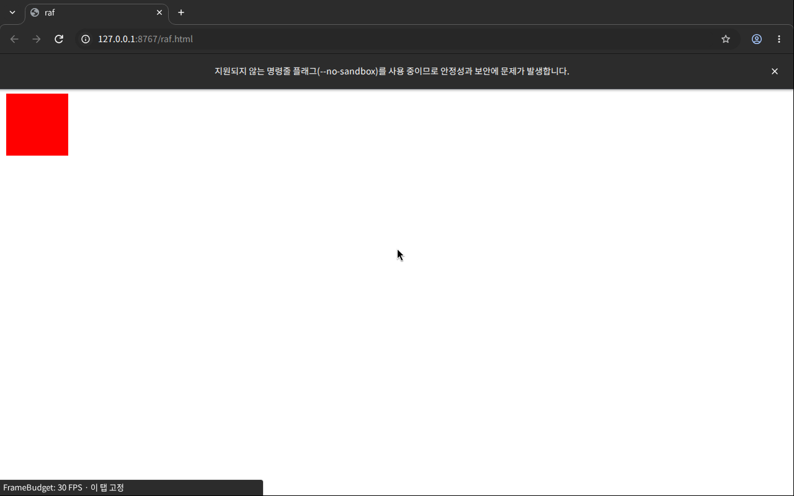
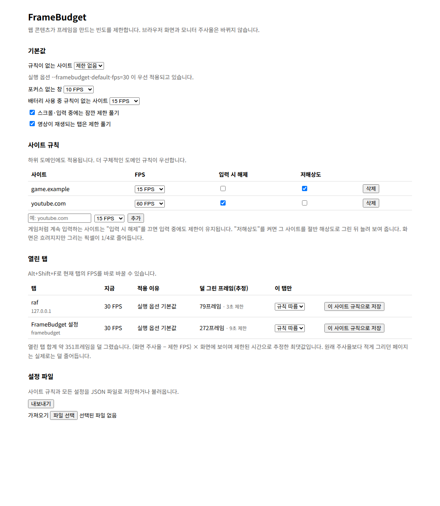

# FrameBudget

**사이트·탭별 FPS 예산으로 웹 렌더링 전력을 줄이는 오픈소스 브라우저 (Chromium 기반)**

*An open-source Chromium-based browser that cuts rendering power with per-site, per-tab frame-rate budgets.*

> 현재 단계: Chromium 패치를 빌드해 동작과 전력 절감을 확인했고, Linux용 실행 파일을 [Release](https://github.com/dark-ran/framebudget/releases/tag/v0.1.0)로 배포합니다. 진행 상황은 [로드맵](#로드맵)에서 확인할 수 있습니다.

## 문제

요즘 모니터는 120Hz, 144Hz가 흔하고, 웹 페이지는 애니메이션, Canvas, WebGL 게임처럼 쉬지 않고 화면을 다시 그리는 경우가 많습니다. 브라우저는 기본적으로 모니터 주사율에 맞춰 최대한 부드럽게 그리기 때문에, 사용자가 "이 사이트는 15프레임이면 충분하다"고 판단해도 이를 선택할 방법이 없습니다. 그 결과 노트북에서는 배터리가, 데스크톱에서는 전력과 발열이 불필요하게 소모됩니다.

## 아이디어

FrameBudget은 **웹 콘텐츠가 프레임을 만드는 빈도 자체를 사이트·탭별로 제한**합니다.

- **사이트·탭별 FPS 예산:** 영상 사이트는 60FPS, 뉴스·문서는 15FPS, 특정 탭은 5FPS처럼 따로 정합니다.
- **연산 자체를 줄입니다:** 그린 프레임을 버리는 것이 아니라 처음부터 덜 그리도록 하여 CPU·GPU 작업을 줄입니다.
- **모니터와 브라우저 UI는 그대로 둡니다:** 모니터 주사율을 바꾸지 않으며, 탭 전환·주소창 같은 브라우저 화면은 계속 부드럽게 동작합니다.
- **입력 중에는 잠시 해제합니다:** 스크롤, 타이핑, 클릭 중에는 제한을 풀고, 입력이 멈추면 다시 적용하여 사용성을 유지합니다. 게임처럼 계속 입력하는 사이트는 사이트별로 이 해제를 끌 수 있습니다.
- **서버에 따로 알리지 않습니다:** 제한 설정을 웹사이트에 전송하지 않으며, 페이지는 화면 갱신이 느린 환경에서 실행되는 것처럼 동작합니다. 단, 페이지가 프레임 간격을 직접 측정하여 이를 알아채는 것까지 막을 수는 없습니다.

## 내려받기와 실행

[Release v0.1.0](https://github.com/dark-ran/framebudget/releases/tag/v0.1.0)에서 Linux x86-64용 묶음(164MB)을 받습니다. Ubuntu에서 빌드하고 시험했으며, Windows와 macOS에서는 실행되지 않습니다.

```bash
sha256sum -c FrameBudget-156.0.8078.48-linux-x64.tar.xz.sha256
tar -xJf FrameBudget-156.0.8078.48-linux-x64.tar.xz
./FrameBudget-156.0.8078.48-linux-x64/framebudget
```

- 주소창에 `chrome://framebudget`을 입력하면 기본값, 사이트 규칙, 열린 탭의 상태를 보고 바꿀 수 있습니다.
- Alt+Shift+F로 현재 탭의 FPS를 60 → 30 → 15 → 5 → 제한 없음 → 규칙 따름 순으로 바꿉니다.
- Ubuntu 23.10 이후는 AppArmor 때문에 Chromium 샌드박스가 동작하지 않습니다. 이 경우 실행 스크립트가 `--no-sandbox`를 붙이고 경고를 표시합니다. 시험용으로만 쓰는 것을 권합니다.
- 직접 빌드하려면 [Chromium 빌드 문서](chromium/README.md)를 봅니다.



## 기존 기술과의 차이

| | 하는 일 | FrameBudget과 다른 점 |
|---|---|---|
| Opera GX GX Control | CPU·RAM·네트워크 사용량에 상한을 겁니다 | 사용 가능한 자원을 제한하는 방식입니다. FrameBudget은 수행해야 할 렌더링 작업 자체를 줄입니다 |
| Chrome 에너지 세이버 | 배터리 사용 시 프레임을 30Hz로 낮춥니다 | 30Hz로 고정되어 있으며, 사이트를 선택할 수 없습니다 |
| Firefox `layout.frame_rate` | 브라우저 전체의 프레임 빈도를 지정합니다 | 숨은 설정이며, 브라우저 전체에 하나의 값만 적용됩니다. 브라우저 UI와 스크롤까지 함께 느려집니다 |
| 확장 프로그램 (페이지 스크립트 제한) | `requestAnimationFrame` 콜백을 걸러 냅니다 | CSS 애니메이션은 줄이지 못합니다 (아래 실험 참고) |

FPS를 제한하는 기술 자체는 새롭지 않습니다. FrameBudget의 목표는 이를 **사이트·탭 단위의 사용자 정책**으로 만들고, 실제로 전력이 얼마나 줄어드는지를 **측정으로 입증하는 것**입니다.

## 사전 실험: FPS를 낮추면 전력이 실제로 줄어드는가

브라우저를 수정하기 전에, 이미 브라우저 수준의 제한 기능이 있는 Firefox(`layout.frame_rate`)로 가설을 먼저 확인했습니다.

- **환경:** 노트북 (Intel Core Ultra 5 125U, 내장 GPU, 60Hz 화면), Firefox 159
- **측정:** Intel RAPL CPU 패키지 전력 (Windows Energy Meter 카운터). 조건 순서를 바꿔 가며 반복 측정한 중앙값
- **장면:** 직접 만든 테스트 페이지 (CSS 애니메이션, Canvas 2D, WebGL) + 외부 3D WebGL 게임 페이지

| 장면 | 제한 없음 | 15FPS (브라우저 수준) | 15FPS (페이지 스크립트만 제한)¹ |
|---|---|---|---|
| CSS 애니메이션 | 4.45W | 3.06W (**−31%**) | **변화 없음** (0%) |
| Canvas 2D | 5.82W | 3.85W (**−34%**) | −32% |
| WebGL | 4.41W | 3.06W (**−31%**) | −35% |
| 외부 3D WebGL 게임 | 12.9W | 6.0W (**−54%**) | — |

¹ 별도 회차에서 측정하여, 같은 회차의 "제한 없음" 대비 비율만 표기했습니다.

- 화면이 움직이는 페이지에서는 15FPS 제한으로 CPU 패키지 전력이 **31~54%** 줄었습니다.
- 정적인 문서에서는 차이가 없었습니다. 효과는 계속 움직이는 콘텐츠에서만 나타납니다.
- 페이지 스크립트만 제한하는 방식(확장 프로그램 수준)은 CSS 애니메이션을 전혀 줄이지 못했습니다. 이는 **브라우저 엔진 수준의 제한이 필요하다는 근거**입니다.
- 한계: 노트북 한 대, 60Hz 화면에서 디스플레이를 제외한 CPU 칩 전력만 측정한 결과입니다. 게임은 조작하지 않고 실행해 둔 상태에서 측정했습니다.

측정 도구와 원본 데이터는 [`bench/`](bench)에 있습니다.

## FrameBudget 빌드 측정 결과

직접 빌드한 FrameBudget 브라우저로 같은 장면을 다시 측정했습니다. 같은 브라우저에서 페이지 스크립트만 제한하는 방식(확장 프로그램 수준, `js`)도 함께 재서 비교했습니다.

- **환경:** 데스크톱 (AMD Ryzen, NVIDIA GeForce RTX 5060 Ti, 1920×1080 100Hz), Ubuntu, 창 모드
- **측정:** CPU 패키지 전력(RAPL) + 외장 GPU 전력(`nvidia-smi`)의 합계. 조건마다 40초씩 3회, 조건 순서를 돌려 가며 측정한 중앙값 (2026-11-17)
- **원본:** [`bench/results/20261117-143526-chrome-budget`](bench/results/20261117-143526-chrome-budget), [`bench/results/20261117-151229-chrome-js`](bench/results/20261117-151229-chrome-js)

| 장면 | 제한 없음 | FrameBudget 30FPS | FrameBudget 15FPS | 페이지 스크립트만 15FPS² |
|---|---|---|---|---|
| 정적 문서 | 24.0W | 23.1W (−4%) | 23.1W (−4%) | 23.7W (−1%) |
| CSS 애니메이션 | 45.6W (36FPS) | 38.3W (**−16%**) | 32.3W (**−29%**) | 46.3W (**+1%**, 36FPS 그대로) |
| Canvas 2D | 52.9W (84FPS) | 37.6W (**−29%**) | 32.2W (**−39%**) | 32.8W (−38%) |
| WebGL | 32.6W (100FPS) | 26.6W (**−19%**) | 25.0W (**−23%**) | 25.5W (−22%) |

² 별도 회차에서 측정하여, 같은 회차의 "제한 없음" 대비 비율로 표기했습니다.

- **움직이는 페이지에서 15FPS 제한으로 CPU+GPU 전력이 23~39% 줄었습니다.**
- **CSS 애니메이션은 FrameBudget만 줄였습니다.** 페이지 스크립트만 제한하는 방식은 FPS도 전력도 그대로였습니다. Firefox 사전 실험과 같은 결과를 실제 FrameBudget 빌드로 다시 확인한 것입니다.
- Canvas와 WebGL처럼 스크립트가 직접 그리는 장면에서는 두 방식의 효과가 비슷했습니다.
- WebGL은 그리기를 외장 GPU가 맡아서 CPU 패키지 전력은 12%만 줄었습니다. 외장 GPU 전력은 13.8W에서 8.4W로 줄었습니다. 외장 GPU를 함께 재지 않았다면 효과를 작게 봤을 것입니다.
- CSS 장면은 제한 없음일 때도 36FPS밖에 나오지 않을 만큼 무거워서, 30FPS 제한의 효과가 작게 나왔습니다.
- 이 측정은 패치 0011 이전 빌드로 했습니다. 그래서 100Hz 화면에서 30FPS 열은 실제로 28~32FPS로 그려졌습니다. 0011 이후에는 30FPS 상한이 25FPS가 되므로 절감 폭이 더 커질 수 있지만, 다시 측정하지는 않았습니다. 15FPS 열은 0011의 영향을 받지 않습니다(수정 전후 모두 14~15FPS).
- 한계: PC 한 대에서만 측정했습니다. 값은 브라우저만이 아니라 PC 전체의 CPU 패키지 전력과 GPU 전력이고, 아무것도 하지 않을 때도 약 24W가 나옵니다. 모니터 전력은 포함하지 않았습니다. 장면은 직접 만든 시험 페이지입니다.

## 설계

Chromium에는 이미 프레임 제한 API(`content::UpdateThrottlingFrameSinks`)가 있지만, 여러 탭에 **하나의 값**만 적용할 수 있습니다. 탭마다 다른 값을 적용하기 위해 세 계층을 수정합니다.

```
chrome://framebudget 설정 화면 · Alt+Shift+F 단축키 · 실행 옵션
        │  사이트 규칙 / 탭 고정 / 기본값 → 탭의 FPS 결정
        ▼
FrameBudgetTabHelper (탭마다 하나)
        │  페이지 이동·입력 감지 → 제한 적용, 입력 중에는 잠시 해제
        ▼
content::SetFrameBudgetForFrameSink()   ← 새로 추가하는 공개 API
        │
        ▼
viz FrameSinkManager (GPU 프로세스)
           프레임 싱크마다 고유한 BeginFrame 간격을 기억하고,
           해당 탭과 하위 iframe에 적용
```

- 다른 제한(에너지 세이버 등)보다 간격을 짧게 만들지 않고, 길게만 만듭니다.
- 화면 캡처 중에는 기존 규칙에 따라 제한이 해제됩니다.
- 우선순위: 탭 고정 → 사이트 규칙 → 기본값.

## 로드맵

- [x] 아이디어와 기존 기술 조사
- [x] 측정 도구 (테스트 페이지, 전력·GPU 자동 측정)
- [x] 사전 실험: Firefox로 FPS 제한의 전력 효과 확인
- [x] Chromium 패치 초안: viz·content 프레임 싱크별 제한
- [x] Chromium 패치 초안: 사이트·탭별 정책, 단축키
- [x] Chromium 패치 초안: 설정 화면, 상태 표시, 입력 시 해제
- [x] Ubuntu에서 패치 빌드, 기본 동작 확인 ([빌드 방법](chromium/README.md))
- [x] 빌드한 FrameBudget으로 전력 재측정 (Firefox 결과와 비교)
- [x] 사이트별 "입력 시 해제" 끄기 (게임처럼 계속 입력하는 사이트용)
- [x] 외장 GPU(100Hz 모니터) 환경 측정
- [x] Linux 배포용 빌드와 Release v0.1.0
- [ ] 120·144Hz 모니터 측정
- [ ] 저화질 강제 (Canvas·WebGL 내부 해상도, 이미지 품질) 실험

패치는 Chromium `156.0.8078.48`에 적용해 Ubuntu에서 빌드했습니다. 헤드리스 모드에서 사이트 규칙대로 페이지의 프레임이 60·30·15FPS로 제한되고, CSS 애니메이션도 함께 제한되며, 입력 중에는 제한이 잠시 풀리는 것을 확인했습니다. 창 모드에서 Alt+Shift+F 단축키와 상태 표시도 확인했습니다. 자세한 내용은 [Chromium 빌드 문서](chromium/README.md)에 있습니다.



## 라이선스

이 저장소의 코드는 [BSD-3-Clause](LICENSE)입니다. Chromium과 같은 라이선스입니다.

- [`chromium/patches/`](chromium/patches)는 [Chromium](https://www.chromium.org/) 소스를 수정하는 패치입니다. 기존 Chromium 파일을 고친 부분은 Chromium 라이선스([원문](chromium/LICENSE.chromium), Copyright The Chromium Authors)를 따릅니다. 범위는 [Chromium 빌드 문서](chromium/README.md#출처와-라이선스)에 정리했습니다.
- 이 프로젝트는 Google이나 Chromium 프로젝트와 관련이 없습니다. "Chrome"은 Google LLC의 상표입니다.
