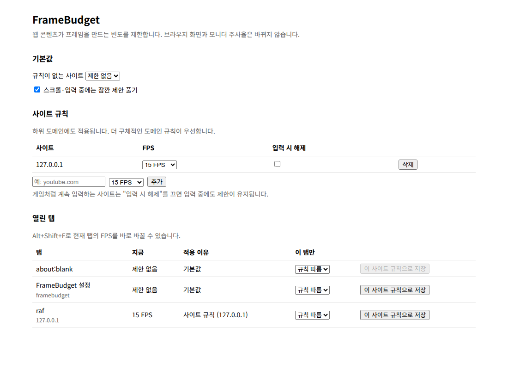
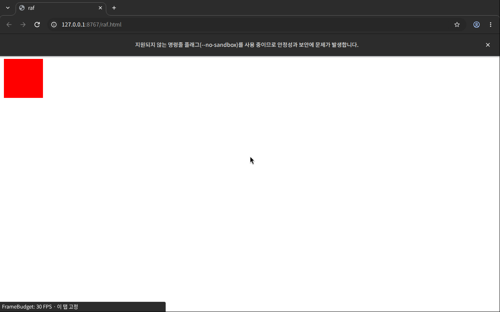
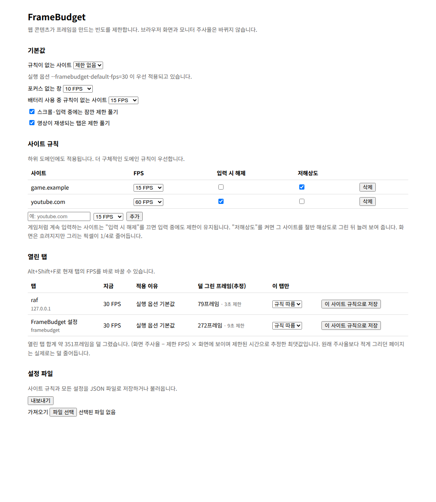

# FrameBudget Chromium 빌드

FrameBudget 기능은 Chromium 원본 소스에 적용하는 패치로 제공합니다. Chromium 소스 전체(약 50GB)는 이 저장소에 넣지 않습니다.

- **기준 버전:** Chromium `156.0.8078.48` (commit `d0c02bfad0`)
- **확인한 환경:** Ubuntu, CPU 16코어, 메모리 30GB

## 패치

[`patches/`](patches)의 파일을 번호 순서대로 적용합니다. 로컬 Chromium 저장소의 커밋을 `git format-patch`로 내보낸 것입니다.

| 패치 | 내용 |
|---|---|
| 0001 | viz·content: 프레임 싱크마다 다른 BeginFrame 간격을 지정하는 API (`content::SetFrameBudgetForFrameSink`) |
| 0002 | chrome: 사이트·탭별 FPS 정책 (`FrameBudgetTabHelper`), 실행 옵션, Alt+Shift+F 단축키 |
| 0003 | chrome: `chrome://framebudget` 설정 화면, 상태 표시, 입력 시 제한 해제 |
| 0004 | 수정: 첫 빌드의 `framebudget_tab_helper.cc` 컴파일 오류 2건 |
| 0005 | 수정: `framebudget_ui.cc` 컴파일 오류 1건 |
| 0006 | 설정 화면 안내 문구 정리 |
| 0007 | 새로 작성한 파일의 저작권자 표기 수정 |
| 0008 | 수정: Alt+Shift+F 단축키가 동작하지 않던 문제 |
| 0009 | chrome: 사이트별로 "입력 시 해제"를 끄는 설정과 실행 옵션 |
| 0010 | 수정: 렌더러가 죽은 뒤 다시 불러오면 제한이 풀리던 문제 |
| 0011 | 수정: 간격을 반올림하지 않고 상한으로 지킴 (100Hz에서 30FPS가 33FPS가 되던 문제) |
| 0012 | chrome: 비활성 창 FPS, 배터리 사용 중 기본값, 단축키 입력은 입력 시 해제에서 제외 |
| 0013 | content·chrome: 사이트별 저해상도 모드 (devicePixelRatio 0.5) |
| 0014 | chrome: 영상이 재생되는 탭은 제한 풀기 (선택) |

0004, 0005, 0008, 0010, 0011은 빌드와 시험에서 나온 오류를 고친 기록입니다. 기능 패치에 합치지 않고 따로 남겼습니다.

- `GURL::host()`가 `std::string_view`를 돌려주는데 `std::string`으로 암시 변환하고 있었습니다.
- `BrowserContext`가 전방 선언만 되어 있어서 `UserPrefs::Get()`에 넘길 수 없었습니다.

14개 패치를 `156.0.8078.48`에 순서대로 적용한 결과가 실제로 빌드한 소스 트리와 같은 것을 git 트리 해시로 확인했습니다.

## 빌드 방법

Chromium 공식 [Linux 빌드 문서](https://chromium.googlesource.com/chromium/src/+/main/docs/linux/build_instructions.md)를 기준으로 합니다. 디스크는 100GB 이상 비워 두는 것을 권합니다.

1. [depot_tools](https://chromium.googlesource.com/chromium/tools/depot_tools.git)를 받아 `PATH`에 추가합니다.
2. 소스를 받고 기준 버전으로 맞춥니다.

   ```bash
   mkdir chromium && cd chromium
   fetch --nohooks --no-history chromium
   cd src
   git fetch --depth 1 origin refs/tags/156.0.8078.48:refs/tags/156.0.8078.48
   git checkout 156.0.8078.48
   gclient sync --no-history --shallow -D
   ```

   확인한 PC에서는 의존성 설치 스크립트를 따로 실행하지 않아도 빌드되었습니다. 빌드 중 시스템 패키지가 없다는 오류가 나면 공식 문서의 `build/install-build-deps.sh`를 실행합니다.

3. 패치를 적용합니다. `FRAMEBUDGET`은 이 저장소를 받은 위치입니다.

   ```bash
   git am "$FRAMEBUDGET"/chromium/patches/*.patch
   ```

4. 빌드합니다.

   ```bash
   gn gen out/Default --args="is_debug=false symbol_level=0 is_component_build=true"
   autoninja -C out/Default -j 6 chrome
   ```

   메모리가 30GB인 PC에서 `-j 6`으로 빌드했습니다. 처음부터 끝까지 약 2시간 30분 걸렸습니다. 메모리가 부족하면 `-j` 값을 줄입니다. 빌드를 중간에 멈췄다가 같은 명령으로 다시 실행하면 남은 부분만 이어서 빌드합니다.

## 사용법

```bash
out/Default/chrome
```

- 주소창에 `chrome://framebudget`을 입력하면 기본값, 사이트 규칙, 열린 탭의 상태를 보고 바꿀 수 있습니다.
- Alt+Shift+F로 현재 탭의 FPS를 바로 바꿉니다.
- 실행 옵션으로도 규칙을 줄 수 있습니다. 실행 옵션은 저장된 규칙보다 우선합니다.

  ```bash
  out/Default/chrome --framebudget-default-fps=30 --framebudget-sites=youtube.com=60,example.com=15
  ```

  사이트 규칙은 하위 도메인에도 적용됩니다.

- 게임처럼 계속 입력하는 사이트는 입력 중에도 제한을 유지할 수 있습니다. `chrome://framebudget`의 사이트 규칙에서 "입력 시 해제"를 끄거나, 실행 옵션 `--framebudget-no-input-boost=game.example,play.example`을 씁니다. 하위 도메인에도 적용됩니다.

  

- **포커스 없는 창:** 다른 창을 보는 동안 그 창의 탭을 더 낮은 FPS로 제한합니다. `chrome://framebudget`의 "포커스 없는 창"이나 `--framebudget-inactive-window-fps=10`으로 정합니다. 원래 값보다 낮을 때만 적용하고, Alt+Shift+F로 고정한 탭은 그대로 둡니다.
- **배터리 사용 중 기본값:** 배터리로 동작할 때 규칙 없는 사이트에 쓸 기본값입니다. "배터리 사용 중 규칙이 없는 사이트"나 `--framebudget-battery-default-fps=20`으로 정합니다. 배터리가 없는 PC에서 시험할 때는 `--framebudget-assume-battery`를 붙입니다.
- Alt+Shift+F와 Alt·Shift 같은 보조키만 누른 입력은 "입력 시 해제"를 일으키지 않습니다.
- **영상 재생 중 해제:** 켜 두면 영상이 재생되는 동안 그 탭의 제한을 풉니다. 기본값을 낮게 잡아도 페이지에 끼워 넣은 영상이 끊기지 않습니다. `chrome://framebudget`의 "영상이 재생되는 탭은 제한 풀기"나 `--framebudget-lift-during-video`로 켭니다. Alt+Shift+F로 고정한 탭은 그대로 둡니다. 가상 화면에서 15FPS 규칙 페이지의 영상을 재생하면 제한이 풀리고(30, 37FPS. 가상 화면은 영상 재생 자체가 30FPS 안팎이 한계입니다), 멈추면 다시 15FPS가 되는 것을 확인했습니다.
- **저해상도 모드:** 지정한 사이트를 devicePixelRatio 0.5로 그리고, 컴포지터가 원래 크기로 늘려 보여 줍니다. 화면은 흐려지지만 캔버스를 devicePixelRatio로 잡는 페이지는 그리는 픽셀이 1/4이 됩니다. `chrome://framebudget` 사이트 규칙의 "저해상도"나 `--framebudget-low-res=game.example`로 켭니다.
  - WebGL 버퍼만 몰래 줄이는 방법은 쓰지 않았습니다. `gl.viewport(0, 0, canvas.width, canvas.height)`처럼 캔버스 크기를 그대로 쓰는 페이지가 잘리기 때문입니다.
  - DevTools 기기 에뮬레이션과 같은 경로를 쓰므로, 저해상도 사이트에서 DevTools 기기 에뮬레이션을 함께 쓰면 서로 덮어씁니다.
  - 전력 효과는 WebGL 장면에서 한 번만 짧게 쟀습니다. CPU+외장 GPU 합계가 38.4W에서 24.9W로 줄었지만, 그때는 WebGL이 소프트웨어로 그려진 것으로 보여 참고값입니다.

## 동작 확인

`requestAnimationFrame` 콜백 수를 초마다 세는 테스트 페이지를 헤드리스 모드로 열었습니다. 실행 옵션으로 규칙을 바꿔 가며 1초씩 5번 측정했습니다.

| 조건 | 초당 프레임 (5회) |
|---|---|
| 제한 없음 | 60, 60, 60, 60, 60 |
| `--framebudget-sites=127.0.0.1=30` | 30, 30, 30, 30, 30 |
| `--framebudget-sites=127.0.0.1=15` | 15, 15, 15, 15, 15 |

`chrome://framebudget` 페이지가 열리고, 실행 옵션으로 준 규칙이 화면에 표시되는 것도 확인했습니다.

### 자동 점검 스크립트

[`tests/headless_check.mjs`](tests/headless_check.mjs)는 빌드한 브라우저를 헤드리스로 띄워 DevTools 프로토콜(CDP)로 아래 항목을 확인합니다. Node 22 이상만 있으면 되고, 시험 페이지도 스스로 띄웁니다.

```bash
node chromium/tests/headless_check.mjs out/Default/chrome --no-sandbox
```

`--no-sandbox`는 Ubuntu 23.10 이후처럼 AppArmor가 사용자 네임스페이스를 막아 `No usable sandbox!`로 실행이 안 될 때만 붙입니다. 로컬 시험 페이지만 여는 점검용입니다.

2026-11-16 결과 (1초 단위 값):

| 항목 | 제한 없음 | `127.0.0.1=15` |
|---|---|---|
| rAF 콜백 수 | 60, 60, 60 | 15, 15, 15 |
| 휠 입력을 2초 동안 보내는 중 | — | 33, 60 |
| 입력을 멈추고 1.5초 뒤 | — | 15, 15 |
| CSS 애니메이션만 있는 페이지의 DrawFrame 수 (3초 평균) | 60 | 15 |

- **CSS 애니메이션도 제한됩니다.** 스크립트 없이 CSS `@keyframes`만 쓰는 페이지에서도 렌더러가 그리는 프레임이 15로 줄었습니다. 페이지 스크립트만 솎아내는 확장 프로그램 방식으로는 줄지 않던 부분입니다.
- **입력 중에는 제한이 풀리고, 입력이 멈추면 다시 걸립니다.** 첫 칸의 33은 1초 구간 중간에 해제가 시작됐기 때문입니다.
- **"입력 시 해제"를 끈 사이트는 입력 중에도 제한이 유지됩니다.** `--framebudget-no-input-boost=127.0.0.1`을 함께 주면 휠 입력 중에도 15, 15였습니다 (2026-11-17). 설정 화면에서 체크 상자를 끄고 켤 때도 15, 15와 60으로 바뀌는 것을 확인했습니다.
- 프레임 수는 화면 캡처(screencast)가 아니라 tracing으로 셉니다. 화면 캡처 중에는 기존 규칙에 따라 제한이 풀리기 때문입니다. 실제로 screencast로 세면 15FPS 규칙에서도 60이 나옵니다.

### 창 모드 확인

가상 화면(Xvfb)에 일반 창으로 띄우고, 실제 X 키 입력(xdotool)으로 확인했습니다 (2026-11-16, `127.0.0.1=15` 규칙).

| 동작 | 초당 rAF |
|---|---|
| 창 모드, 규칙만 적용 | 15, 15, 15 |
| Alt+Shift+F 1회 | 60, 60 |
| Alt+Shift+F 2회 | 30, 30 |
| Alt+Shift+F 3회 | 15, 15 |

누를 때마다 창 왼쪽 아래에 상태가 2초 동안 표시됩니다.





**0008에서 고친 문제:** 처음에는 Alt+Shift+F를 눌러도 FPS가 바뀌지 않았습니다.

- **확인한 것:** `chrome://histograms`의 `Browser.Shortcuts.TriggeredCommandId`에는 FrameBudget 명령(40390)이 기록됐습니다. 단축키는 눌렸는데 명령이 실행되지 않은 것입니다.
- **원인:** Chromium 156은 `kUseActionsForBrowserCommands`가 켜져 있으면 명령 등록부로 `CommandActionUpdater`를 씁니다. 이 등록부는 액션 표에 있는 명령만 인정합니다. 그래서 `SupportsCommand`가 false가 되어 FrameBudget 명령이 버려졌습니다.
- **수정:** `BrowserView::AcceleratorPressed`에서 이 명령을 탭 헬퍼로 바로 넘깁니다.

### 여러 상황 점검

[`tests/window_check.mjs`](tests/window_check.mjs)는 브라우저를 일반 창으로 띄워 아래 상황을 확인합니다. 키 입력은 xdotool로 실제 X 입력을 넣고, 값은 CDP로 읽습니다.

```bash
Xvfb :99 -screen 0 1400x800x24 &
DISPLAY=:99 node chromium/tests/window_check.mjs out/Default/chrome --no-sandbox
```

실제 화면에서 돌릴 때는 `FB_NO_KEYS=1`을 붙여 클릭과 키 입력이 필요한 시험을 건너뜁니다. 창 위치를 데스크톱 환경이 정하므로, 좌표로 클릭하지 않기 위해서입니다.

| 상황 | 기대 |
|---|---|
| 창 두 개를 나란히 띄우고 127.0.0.1=15, localhost=30 | 두 탭이 동시에 각자의 상한 |
| 실제 키 입력 | 입력 시 해제 켠 사이트는 풀리고, 끈 사이트는 유지 |
| 다른 사이트로 이동했다가 돌아오기 | 이동한 사이트의 규칙 |
| 다른 출처 iframe | 탭(최상위 페이지)의 규칙 |
| Alt+Shift+F로 고정한 뒤 다른 사이트로 이동 | 고정 유지 |
| 새로고침, `window.open` 팝업 | 규칙 유지 |
| 렌더러가 죽은 뒤 다시 불러오기 | 다시 제한 |
| 설정 화면에서 규칙·기본값·입력 시 해제를 바꿈 | 열린 탭에 바로 반영 |
| 단축키를 누른 직후 | 단축키 입력으로 제한이 풀리지 않음 |
| 배터리 사용 중 (`--framebudget-assume-battery`) | 규칙 없는 사이트는 배터리 기본값, 규칙 있는 사이트는 규칙값 |
| 창 두 개 중 하나를 클릭 | 클릭한 창은 원래 값, 다른 창은 비활성 창 FPS |
| 저해상도 사이트와 다른 사이트를 오감 | 저해상도 사이트만 devicePixelRatio 0.5 |
| 영상 재생 중 해제를 켜고 영상 재생·정지 | 재생 중에는 해제, 멈추면 다시 제한 |

2026-11-17 결과:

- **가상 화면(Xvfb, 60Hz):** 19개 모두 통과. 2026-11-19 단축키·배터리·비활성 창·저해상도 시험을 더해 28개, 2026-11-21 영상 재생 시험을 더해 30개 모두 통과
- **실제 화면(100Hz 모니터, NVIDIA GPU, `FB_NO_KEYS=1`):** 14개 모두 통과 (2026-11-18). 2026-11-21 배터리·저해상도·영상 재생 시험을 더해 20개 모두 통과(영상 재생 중 100, 85FPS로 해제, 멈춘 뒤 14FPS). 비활성 창 시험을 클릭 대신 `Target.activateTarget`으로 바꿔 실제 화면에서도 돌렸고, 24개 모두 통과(활성 창 100FPS, 비활성 창 10FPS)
- 판정 기준은 "상한을 넘지 않고, 상한의 75% 이상"입니다. 화면 주기 때문에 상한보다 낮게 나올 수 있기 때문입니다.

**이 점검으로 찾아 고친 문제 2가지**

- **0010 (렌더러 크래시):** 15FPS 규칙 탭에서 렌더러가 죽은 뒤 다시 불러오면 100FPS로 돌았습니다.
  - 원인: viz는 죽은 렌더러의 프레임 싱크와 함께 저장한 간격도 지웁니다. 그런데 다시 불러올 때 프레임 싱크 ID가 같아서, 탭 헬퍼는 "이미 적용했다"고 보고 다시 보내지 않았습니다.
  - 수정: `PrimaryMainFrameRenderProcessGone`에서 적용 기록을 지웁니다.
- **0011 (상한 초과):** 100Hz 모니터에서 30FPS로 제한하면 33~34FPS가 나왔습니다.
  - 원인: viz는 제한 간격을 가장 가까운 화면 주기로 반올림합니다(반 주기 여유). 그래서 33.3ms 간격이 30ms 간격이 됐습니다. 60Hz에서는 33.3ms가 정확히 화면 주기 2번이라 드러나지 않았습니다.
  - 수정: FrameBudget이 간격을 정하는 프레임 싱크에서는 간격이 다 지난 뒤에만 그립니다. 타이밍 흔들림만 1/10 주기 허용합니다. 에너지 세이버 같은 다른 제한의 동작은 그대로 둡니다.
  - 그 결과 100Hz에서 30FPS 상한은 25FPS가 됩니다. 15FPS는 수정 전후 모두 14~15FPS입니다.

전력 절감량은 [저장소 README](../README.md#framebudget-빌드-측정-결과)에 정리했습니다.

## 출처와 라이선스

이 패치는 [Chromium](https://www.chromium.org/) 소스(`156.0.8078.48`)를 수정합니다. 패치 안의 코드는 두 종류이며, 라이선스는 모두 BSD-3-Clause입니다.

| 범위 | 저작권자 | 라이선스 |
|---|---|---|
| 새로 작성한 파일 (`chrome/browser/ui/framebudget/` 전체) | WieHyunSeo | 이 저장소의 [LICENSE](../LICENSE) |
| 기존 Chromium 파일을 고친 부분 (viz, content, chrome의 기존 파일) | 원본은 The Chromium Authors | [LICENSE.chromium](LICENSE.chromium) (Chromium 원문) |

빌드한 브라우저에는 Chromium과 그 안의 제3자 코드(Skia, V8 등)가 함께 들어갑니다. 이 코드들은 각자의 라이선스를 따릅니다. 빌드 결과물을 배포할 때는 제3자 라이선스 고지문을 함께 넣습니다. 고지문은 Chromium 소스의 `tools/licenses/licenses.py`로 만들 수 있으며, 브라우저의 `chrome://credits` 페이지와 같은 내용입니다.

이 프로젝트는 Google이나 Chromium 프로젝트와 관련이 없습니다. "Chrome"은 Google LLC의 상표입니다.
